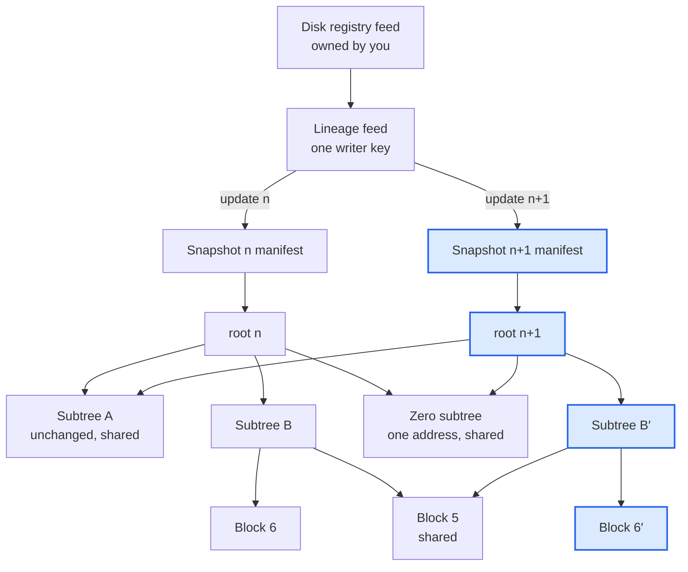
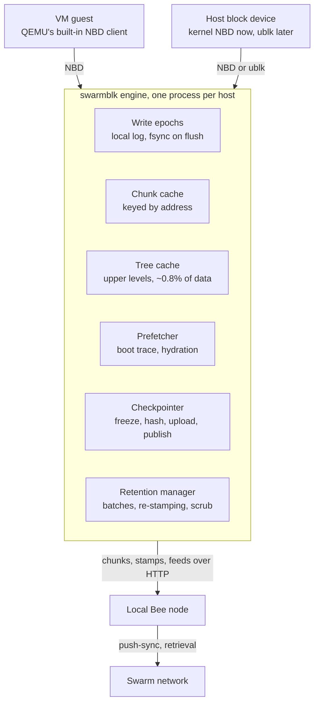

# swarmblk — design

*Design v2, 25 October 2026. Formats and invariants are in [SPEC.md](SPEC.md); the plan is in [ROADMAP.md](../ROADMAP.md); the first measurements are in [PHASE0.md](PHASE0.md).*

swarmblk is a virtual disk whose snapshots live on Ethereum Swarm. A local engine serves the disk over NBD, keeps writes on local storage, and publishes checkpoints as new Swarm trees that share every unchanged chunk with the snapshot before.

## 1. Decisions at a glance

1. **A block device, so guests run unmodified.** A snapshot is a whole machine, crash-consistent, and nothing above the block layer needs to know about Swarm. In return, cold reads wait for Swarm, and a single file comes out only through the guest's filesystem. The [README](../README.md#why-a-block-device) compares the alternatives and says where this is fast enough.
2. **A snapshot is an ordinary Swarm file**, uploaded at redundancy level 0. Its chunk tree is the block map; there is no separate mapping structure.
3. **Phase 0 uses stock tools.** QEMU's HTTP block driver boots from a Bee `/bytes` URL under a local qcow2 overlay. Measure before building the engine.
4. **Postage is the central design problem.** Immutable batches only, one stamp issuer per batch, and rotation that re-stamps the deduplicated live set.
5. **Encryption.** Public base images stay unencrypted; private disks use LUKS inside the guest (provisional, see §11).
6. **One writer per lineage.** What looks like sharing becomes branching; shared writable disks are out of scope.
7. **First application: VM disaster recovery with live restore**, then golden images (provisional, see §11).
8. **An external engine over NBD, written in Go**, importing Bee's own packages. No QEMU block driver.

## 2. Data model

A snapshot is a raw disk image stored as a standard Swarm file at redundancy level 0, so its chunk tree maps every 4 KiB block to a content address. Leaves are 4 KiB chunks, and each intermediate chunk holds up to 128 references of 32 bytes. Block *b* is leaf *b*, and its path is the base-128 digits of *b*, so no lookup table is needed.

Bee uploads with medium erasure coding by default, which changes the geometry (see Constraints), so every upload must set `Swarm-Redundancy-Level: 0`.

In this two-level sketch, changing block 6 uploads three tree chunks (the new block, its parent and the root) plus a few fixed chunks for the manifest and the feed update. Highlighted nodes are new; everything else is reused by reference.

The tree gives four things for free:

- **Copy-on-write.** Changing one block rewrites its leaf and one chunk per level above it: five tree chunks on a 64 GiB disk. Many dirty blocks share the upper rewrites, and every untouched subtree keeps its address.
- **Thin provisioning.** All-zero chunks share one address, and so do all-zero subtrees at each level (512 KiB, 64 MiB, 8 GiB, 1 TiB). An empty 1 TiB disk is five unique chunks.
- **Cheap diffs.** Walking two roots top-down skips identical subtrees, so listing changed blocks costs about one chunk read per changed region per level. That gives incremental replication, forensic diffs and fast catch-up between hosts.
- **Interoperability.** Any Swarm tool can fetch a snapshot as a raw image (`/bytes/<root>`, `/bzz/<manifest>/disk.raw`, swarm-cli, swarmfs), and anyone can verify it by recomputing the root.

Four constraints come with it:

- **Trees match Bee's byte for byte.** Bee carries a lone reference up a level instead of wrapping it; power-of-two disk sizes avoid that edge case everywhere but the root. Build trees with Bee's Go packages and test against Bee's pipeline on many sizes.
- **Erasure coding is opt-in.** At the medium level each group holds 119 data chunks and 9 parities, so the tree becomes 119-ary and every scattered changed block also rewrites its group's parities: up to ten times the chunks per checkpoint. An archival copy can be rebuilt with erasure coding later, since its leaves stay the same and only intermediates and parities are new.
- **Size is fixed per lineage.** Resizing builds a new tree that reuses every leaf but rebuilds the levels above. Format 1 allows power-of-two sizes from 64 MiB to 1 TiB; thin provisioning makes rounding up free.
- **512-byte logical, 4 KiB physical sectors (512e).** Existing images keep working and guests align to 4 KiB. A sub-4 KiB write to a block not yet fetched is logged and merged later, never held up by a Swarm read.

Three thin layers sit above the tree:

- **Snapshot manifest:** a small Mantaray manifest holding `disk.raw` (the tree root), `meta.json` (size, sectors, parent, lineage position, creation time, batch IDs, encryption, consistency) and an optional `prefetch.bin` boot trace.
- **Lineage feed:** a sequence feed owned by the writing host's key, where update *n* points to snapshot *n*. Parent links in `meta.json` keep history walkable even without the feed.
- **Disk registry:** a feed owned by the person or organisation that maps a disk name to its current lineage. Handoff and takeover move this pointer (§7).

## 3. Read path

Every cold read should cost one network round trip; the engine gets there by caching the tree's upper levels locally and prefetching in parallel. Without that cache, tree depth multiplies latency:

| Disk size | Intermediate levels | Fetches per cold read, nothing cached | Intermediate chunks, fully allocated |
|---|---|---|---|
| 8 GiB | 3 | 4 | 65 MiB |
| 64 GiB | 4 | 5 | 516 MiB |
| 1 TiB | 4 | 5 | 8.1 GiB |

Intermediate chunks are 1/128 of allocated data (0.8%).

The engine's read rules:

- **Fetch chunks, not ranges.** The engine calls `GET /chunks/{address}` and walks the tree itself, which gives it control of parallelism, caching and verification. `/bytes` range reads are for Phase 0 only.
- **Cache every intermediate chunk.** With them local, each cold read is one retrieval instead of five.
- **Short-circuit zeros.** The engine knows the zero-subtree address at each level, returns zeros without a fetch, and reports those ranges as holes through NBD block status.
- **Verify every chunk.** Recomputing the BMT hash means the Bee node or gateway is trusted for availability and privacy, not integrity.
- **Share one chunk cache.** A local store keyed by Swarm address serves all snapshots and lineages. Chunks uploaded at a checkpoint go straight into it, so a host never re-fetches its own writes.
- **Prefetch from a boot trace.** Record which blocks a boot reads, in order, and store the list in the snapshot manifest; on the next cold boot, fetch it in parallel ahead of the guest. Containers show why this works: Slacker found that pulling images took 76% of start time, yet only 6.4% of the pulled data was read.
- **Hydrate by policy, not by default.** Each disk chooses one of three:
  - *lazy:* demand reads and trace prefetch only, with a bounded chunk cache. The cache drops the leaves used least recently and keeps the tree, so a cold read still costs one fetch.
  - *hydrate:* copy the whole snapshot locally in the background, fetching what the guest touches first, as dm-clone, Proxmox live restore and EBS volume restore do. The copy is a sparse image file beside the disk's epochs, outside the cache. A checkpoint moves it on with the blocks it uploaded, so it is never fetched again, and a complete copy runs the disk with no network at all.
  - *re-stamp only:* fetch each live chunk once to stamp it under the host's own batch, then discard it (§5).

  Lazy suits golden images, CI and forensics, where most blocks are never read. Hydrate suits disaster-recovery restores that must outlive a network outage or an expired batch: a CirrOS disk hydrated through node A then booted with no Bee running at all, and its checkpoints caught up when Bee came back.
- **Fail visibly.** When a fetch's retries run out, the engine either blocks the read or returns an I/O error. ext4 remounts read-only on the first error, so the default is to block: the read tries again after 1, 2, 4 … and at most 30 seconds, until Swarm delivers or the guest's client goes. The guest sees a slow disk. serve raises an alarm when the first read starts waiting, in its log and through an optional command, repeats it every minute, and clears it when reads go through again.

Erasure coding protects availability, not random-read latency: at the medium level, rebuilding one missing 4 KiB block takes 119 other chunks of its group. It pays off in sequential reads and hydration, where the whole group is read anyway.

Reads are metered. Each peer connection forgives a little debt every second (Bee's time-based settlement; a light node gets a tenth of a full node's rate), and the rest is paid by cheque. In Phase 0 that allowance covered about 82% of a light node's reads. It grows with the number of connections, though, and is unlikely to last, so budget at full price (October 2026):

- **About 0.81 xBZZ per GiB through forwarding,** and 0.58 xBZZ per GiB direct from storers.
- **For the Phase 0 Ubuntu image,** that is 0.16–0.23 xBZZ for its 307 MiB boot trace and 0.95–1.34 xBZZ for all 1.8 GB of its distinct data.

Bulk transfers (prefetch, hydration, re-stamping) pay as they go, so their rate is a cost setting as well as a speed one; whatever comes free is a bonus. A light node also sustained only about 170 chunks/s (0.7 MB/s) however many requests were in flight, which looks bound by settlement rather than parallelism. Faster bulk transfers therefore need more nodes, or prepaid direct fetching from storers as in [directswarm](https://github.com/petfold/directswarm).

Cold boot ≈ dependent-read chain length × retrieval latency without prefetch; with prefetch it is ≈ bytes read ÷ parallel throughput. Phase 0 measured both inputs, and Phase 2 confirmed them: through one light node, an Alpine boot that reads 70 MiB took 17–18 minutes one read at a time and 3.5 minutes with its trace prefetched ([results](results/phase2-cold-2026-10-26.md)).

## 4. Write path and checkpoints

Writes land on local storage. A checkpoint freezes a write epoch, uploads only the 4 KiB chunks whose content changed, rebuilds the paths above them and publishes the new root last.

The engine keeps an active write epoch: a local log of blocks written since the last freeze, with a checksummed index so it can be replayed after a crash. A guest flush or FUA write is acknowledged only once log and index are durable. Reads look in the active epoch, then any frozen epoch, then the snapshot tree.

A checkpoint runs while the guest keeps writing:

1. **Freeze.** Cut the log atomically: every completed write in, nothing in flight half in. That is crash-consistent without waiting for a guest flush; for application consistency, freeze the guest filesystem first through the QEMU guest agent.
2. **Find changes.** Hash each block in the frozen epoch and skip any whose address is already covered: the parent's leaf, the zero chunk, or any chunk stamped in a live batch.
3. **Upload leaves.** Push the remaining chunks with stamps from this host's current batch, under one upload tag.
4. **Rebuild paths.** Recompute the intermediate chunks bottom-up along the affected paths and upload them, root last.
5. **Upload the manifest** with its `meta.json`.
6. **Confirm.** Poll the tag until every new chunk is synced, then spot-check retrievability on a sample. A chunk-stream acknowledgement means stored locally, not pushed.
7. **Publish.** Write lineage feed update *n+1*, pointing to the manifest.
8. **Retire the epoch.** Its blocks now live in the chunk cache under their addresses.

Four consequences:

- **Upload volume is the net change.** Rehashing makes dirty-tracking granularity a local CPU cost, not an upload cost: a 64 KiB dirty extent with one changed block uploads one chunk. Rewriting identical data uploads nothing.
- **Retries cost no slots, on the same node.** Bee's stamper keeps one slot per batch and chunk address, but that map lives on the issuing node, so it must survive crashes along with the epoch log.
- **Discards keep snapshots thin.** TRIM maps blocks to the zero chunk. Without it, deleted files stay in every later snapshot and keep costing postage.
- **Offline checkpoints squash.** Checkpoints queued while offline become one on reconnect, unless policy keeps each.

Each write moves through four states:

| State | Reached when | Protects against |
|---|---|---|
| Locally committed | log and index are durable | guest or host crash |
| Uploaded | the tag shows every new chunk synced | nothing more yet: until the root is published, no one can find the data |
| Published | the lineage feed points to the manifest | loss of the host; restorable anywhere |
| Retained | stamps cover every reachable chunk past the target date | data loss while balances last; the date is a forecast, since storage prices move |

Between checkpoints, data exists only on the host. Three settings trade recovery point against cost:

- **Checkpoint-only** (default): the recovery point is the checkpoint interval, and postage tracks net change.
- **Journal mode:** upload blocks once they have been unchanged for *T* seconds and append segments of (block, address) records to a journal feed. Recovery is the last snapshot plus the journal, so the recovery point is about *T*, but postage then tracks settled write volume — far more than net change for logs and databases.
- **Local replication** (RAID 1, DRBD) is cheaper for short recovery points and independent of Swarm.

## 5. Postage, retention and garbage collection

Postage decides what survives, so swarmblk treats batches as retention classes with expiry dates, rather than hoping old snapshots stay retrievable. Four facts drive the design:

- **Use immutable batches only.** When a mutable batch's bucket fills, the newest chunk replaces the oldest in that bucket — possibly an unchanged block the current snapshot still references.
- **One stamp issuer per batch.** Only the issuing node enforces immutability; storers keep the newer of two chunks that share a batch and index, whatever the batch type. Two hosts stamping from one batch, or a host that loses its stamper state, silently evict live chunks, so each host gets its own batches.
- **Immutable batches never free a slot.** Every distinct chunk written stays charged until its batch expires, even after its snapshot is deleted. Cost is amount × 2^depth: you pay for capacity over time, whether or not anything still references the chunks.
- **Buckets fill unevenly.** Plan with effective capacity: 7.7 GB at depth 22 (45% of nominal), 19.9 GB at depth 23 (58%) and 47.1 GB at depth 24 (68%). A 64 GiB disk with 20 GiB in use is about 5.3 million chunks (21.6 GB), so its first snapshot already needs depth 24.

The retention manager works from one invariant: every chunk reachable from a snapshot kept until date *D* carries a stamp from a batch that lives past *D*. Batch lifetimes are forecasts, because balances drain at the current storage price, so the manager re-checks them continuously and keeps a margin. Its jobs:

- **Generations.** Base images go in a long-lived batch and deltas in short-lived generation batches. Promoting a snapshot to long-term retention re-stamps only those of its chunks not already covered.
- **Bucket watch.** Track per-bucket fill (`GET /stamps/{id}/buckets`). When the fullest bucket nears capacity, start a new batch for new chunks or dilute this one, because a full bucket makes the next checkpoint fail.
- **Rotation.** When an old batch is mostly dead chunks, buy a fresh one, re-stamp the deduplicated live set into it and stop topping up the old one. The engine does this chunk by chunk: `PUT /stewardship/{ref}` visits every reference rather than every unique chunk, so on an empty 1 TiB disk it would push the zero chunk 2^28 times.
- **Adoption.** A branch depends on its parent's stamps: if a base image's publisher stops paying, every disk built on it breaks. Manifests list the batch IDs they rely on, so dependants can watch those batches on chain and re-stamp the whole tree under their own batch before expiry.
- **Scrub and repair.** Sample chunks of retained snapshots, check retrievability, and re-push missing ones from the local cache. Pin the latest snapshot locally as a self-contained restore source.

Deleting a snapshot drops it from the retention set, and its unique chunks lapse when their batches expire. Deletion is not erasure: until then, anyone holding the references can still read them.

## 6. Encryption and sharing

Public base images stay unencrypted so everyone shares their chunks. Private disks use LUKS inside the guest, which keeps snapshot-to-snapshot deduplication and keeps keys off the host.

| Option | Dedup between snapshots of one disk | Dedup across disks | Change detection by rehash | Keys on the host |
|---|---|---|---|---|
| None (public images) | yes | yes | yes | none |
| LUKS in the guest | yes, with aes-xts-plain64 (the usual default) and no random-IV integrity mode | no | yes | no |
| Swarm chunk encryption (random key per chunk) | yes, by copying references | no | needs a local plaintext index | yes |
| Keyed convergent (key = HMAC(disk secret, block content)) | yes | within one key domain | yes | yes |

Swarm's 64-byte encrypted references halve the branching factor, so tree metadata doubles to 1.6% and large disks gain a level. Keyed convergent encryption stays readable through Bee if it writes Bee's encrypted-chunk format with a derived key instead of a random one. Format 1 uses unencrypted references only.

What each option leaks:

- **All of them** show which blocks changed between snapshots to anyone who can read the trees, and show access patterns to the nodes serving them.
- **LUKS with XTS** also shows changes at 16-byte granularity and reveals when a sector returns to earlier contents, across the whole retained history. Integrity modes with random IVs, such as aes-gcm-random, end dedup, and re-encrypting or changing the volume key rewrites every block.
- **LUKS with discards passed through** reveals the free-space map; without discards, snapshots stay fat. Choose per disk.
- **A LUKS device cannot sit on a shared public base**, so keep the OS disk (public base) apart from the data disk (private).

To share a snapshot with named people, publish its manifest reference under ACT. With Swarm ID, grantees can be accounts rather than Bee nodes. Revocation is forward-only: a grantee who could read snapshot *n* keeps it.

## 7. Writers, lineages and handoff

A lineage has one writer at a time, set by who holds its feed key; anything that looks like shared writing becomes a branch. Swarm has no locks or compare-and-swap. If two running hosts hold the same feed key, both can write update *n* and readers may see either, so a lineage key never sits on two live hosts.

- **Branch:** start a new lineage whose first snapshot names any existing snapshot as its parent. No data is copied.
- **Handoff** (planned move): host A pauses, publishes a final snapshot and seals its lineage. The registry then names a lineage owned by host B, starting from A's final snapshot, and B stamps with its own batches.
- **Takeover** (host A died): power-fence host A, then point the registry at a new lineage from A's last published snapshot. Writes after that snapshot are lost; that is the recovery point.
- **Fencing:** before each publish, a writer checks that the registry still names its lineage and stops if not. A race can still leave an orphaned snapshot, but the registry decides which lineage is current. Strong fencing would need an on-chain register, which is not planned.
- **Restore anywhere:** a secret disk card — lineage, snapshot, batch IDs, and the machine's definition, UEFI variables and vTPM state — restores from the bare network, like wintercluster's recovery cards. Without the vTPM state, TPM-sealed disks will not unlock. The machine's files go to Swarm under Bee's chunk encryption, so the card holds their keys and must be kept like a private key. It holds no lineage key: a machine booted from it writes a new lineage on the old one's head, and taking the old lineage over waits for the registry (Phase 4), as do the registry address and the disk key.

Read-only consumers are unlimited. Shared writable disks stay out of scope: block devices cannot merge, and cluster filesystems need one coherent shared device.

## 8. Interfaces

Build one external block engine and export it over NBD; don't write a QEMU block driver.

- **VMs through NBD.** QEMU's block drivers live inside the QEMU tree, so a custom one means patching QEMU. QEMU's built-in NBD client already uses NBD block status, so an external server reaches VMs unchanged.
- **Host block devices through kernel NBD now, ublk later.** ublk (io_uring, Linux 6.0+) is faster. Both can deadlock under memory pressure if the engine or Bee needs memory to finish writeback, so mark both processes with `PR_SET_IO_FLUSHER`, lock their memory and never swap onto the device. `serve -iolock` does both for the engine. `swarmblk iolock -- bee start` marks Bee, but memory locks end at exec, so Bee's service manager must protect its memory, such as with systemd's `MemoryMin=`. VMs need neither, since QEMU's NBD client runs in user space.
- **vhost-user-blk** is the later path to VM-grade performance.
- **Bare metal** needs a node before the operating system runs. An initramfs can start Bee and the engine and mount the root disk over NBD (dracut has an NBD root module); [deboot](https://debootdevs.github.io/deboot/) already starts Bee in an initramfs, to download a read-only squashfs root. Or a server on the local network exports the disk to a machine that boots with iPXE.
- **Write the engine in Go.** It can import Bee's own BMT, CAC, splitter, Mantaray, feeds and SOC packages (`github.com/ethersphere/bee/v2/pkg/...`), so trees match Bee's byte for byte. Ethersphere's beekeeper imports Bee the same way.

The engine holds the disk's state; Bee holds each batch's stamp issuer, which must never be shared or lost. Bee accepts pre-signed stamps on `/chunks` and `/chunks/stream`, so if the engine later signs its own stamps and keeps verifying every chunk, Bee can become a remote gateway instead of a local node.

Phase 0's stock-tool setup and its pitfalls (QEMU's 5-second request timeout, 8 requests in flight, Bee's 512 KiB lookahead) are in [PHASE0.md](PHASE0.md). s3backer over s3warm would also run today, but it stores each block as a separate object and so loses the tree's sharing and diffs.

## 9. Filesystems on the disk

The guest sees an ordinary disk, so any filesystem works on it: ext4, XFS, Btrfs, ZFS, NTFS or FAT, inside partition tables, LVM or LUKS as usual, and swap or a database can use it raw. Any guest OS runs on it in a VM, and a Linux host can mount it through NBD. The filesystem never sees Swarm, but its habits set the costs:

- **One writer at a time.** One machine mounts a disk read-write; others run branches of a snapshot (§7). Cluster filesystems such as GFS2 and OCFS2, which need several machines writing one disk at once, do not fit.
- **The write pattern sets snapshot cost.** ext4 and XFS overwrite in place, so a checkpoint uploads about what changed, plus journal blocks. Copy-on-write filesystems (Btrfs, ZFS) write every change to a new place and rewrite the metadata above it, so each snapshot uploads more new chunks. With an fsync-heavy workload, XFS uploaded 1.2 times the data written, ext4 2.2, ZFS 2.3 and Btrfs 3.5 ([results](results/phase2-crash-2026-10-26.md)). Identical blocks cost one chunk, so Btrfs's two copies of its metadata cost one.
- **Full scans are cold reads.** A boot or a working set touches a small part of the disk, but `fsck`, `find /`, a virus scan or a search indexer fetches most of it at Swarm latency.
- **Discards keep snapshots thin.** With TRIM (`fstrim`, or `discard=unmap` in QEMU), freed blocks become the shared zero chunk (§4).
- **Encryption hides zeros.** Inside LUKS a zero block is ciphertext, so free space stays free only if discards pass through, which reveals the free-space map (§6).
- **Snapshots are crash-consistent.** Journaling filesystems recover on mount, as after a power cut; for application consistency, freeze the filesystem through the guest agent first (§4).
- **Align to 4 KiB.** With 4 KiB filesystem blocks on 1 MiB-aligned partitions, today's defaults, each block is one chunk. A misaligned filesystem splits blocks across two chunks and can double what a checkpoint uploads.

## 10. Use cases, ranked

VM disaster recovery comes first: its reads are rare and tolerate latency, and provider independence is what Swarm offers best.

| Rank | Use case | Why it fits Swarm | Main risk |
|---|---|---|---|
| 1 | VM disaster recovery with live restore | Incremental snapshots, rare latency-tolerant reads, restore on any provider from a disk card | First-boot speed; postage for long retention |
| 2 | Golden images: CI runners, labs, dev machines | One publisher, many readers, free branching; popular chunks get cached along retrieval paths | The publisher must keep paying; cold boots |
| 3 | Forensic and archival images | Immutable, verifiable by root | Needs a standard hash (SHA-256) beside the Swarm root, encryption, and a trusted timestamp, since stamp timestamps are set by the uploader |
| Stretch | Suspend to Swarm, resume elsewhere | Disk plus RAM (the QEMU migration stream) makes "portable machine state" literal | Large memory images; needs lazy page loading |

Legacy software that needs a disk is served by the first two. General-purpose VM disks rank lower: write-heavy, latency-sensitive guests run on the local overlay anyway, so Swarm adds little beyond backup unless machines move. The [README](../README.md#where-it-is-fast-enough) says where swarmblk is fast enough and gives examples.

## 11. Open questions

Measurements (Phase 0):

- Retrieval latency (median and 99th percentile) for random chunks from a light and a full node, and how throughput scales with parallel requests.
- Boot working set and read order for two or three common images, and whether traces survive kernel updates.
- Push-sync throughput for checkpoint-sized uploads through `/chunks/stream`.
- Hydration speed within the free bandwidth allowance, light versus full node.
- Latency and staleness of feed lookups for the latest snapshot. First numbers (2026-10-26, light nodes): a lookup takes 2–5 s, and a new update showed on the first poll, from a second node too. Bee's lookup drops probes slower than 1 s, so a head can lag under load.

Decisions:

- Is disaster recovery the right first target, or golden-image distribution? (Provisional: disaster recovery.)
- Default for private disks: guest LUKS (keys never touch the host) or engine-side convergent encryption (dedup across a fleet)? (Provisional: guest LUKS.)
- Bee cannot answer "is this chunk stamped by a batch that lives past date *D*", so coverage is tracked client-side. Worth proposing such a query to Bee core?

## 12. Decision log

| Date | Decision | Why | Rejected |
|---|---|---|---|
| 2026-10-25 | A block device; guests run unmodified | Every OS, filesystem and application already uses the block layer; a snapshot is a whole machine, crash-consistent | Files or objects (swarmfs, s3warm); storage built for one application; downloading whole images |
| 2026-10-25 | A snapshot is a Swarm file at redundancy level 0 | Sharing, zero dedup, cheap diffs, interoperability with every Swarm tool | A separate mapping tree (v1); erasure coding by default |
| 2026-10-25 | External NBD engine, written in Go | No QEMU patches; Bee's packages give byte-identical trees | A QEMU block driver; a Python engine |
| 2026-10-25 | Immutable batches, one stamp issuer per batch | Mutable wrap-around and cross-issuer index collisions evict live chunks | Mutable batches; batches shared across hosts |
| 2026-10-25 | Rotation re-stamps the deduplicated live set from the engine | `PUT /stewardship` visits every reference | Stewardship-based rotation |
| 2026-10-25 | One writer per lineage; branching instead of sharing | Swarm has no locks or compare-and-swap | Shared writable disks |
| 2026-10-25 | Public bases unencrypted; private disks use guest LUKS (provisional) | Keeps dedup between snapshots; keys stay off the host | Swarm random-key chunk encryption as the default |
| 2026-10-25 | Disaster recovery with live restore first (provisional) | Tolerates read latency; provider independence | General-purpose VM disks first |
| 2026-10-25 | Name: swarmblk | Functional; matches swarmfs and Linux `-blk` naming | mothball, combdrive, capped |
| 2026-10-25 | License: BSD 3-Clause | Matches Bee, which swarmblk imports, and swarmfs and s3warm | — |
| 2026-10-25 | Hydration is a per-disk policy: lazy, hydrate, or re-stamp only | Most workloads never read most blocks; disaster-recovery restores and takeovers need the data | Always hydrating every disk |
| 2026-10-25 | Phase 0 gate: go on to Phase 1; set the cold-boot bound against an engine prototype | Stock tools cold-booted Ubuntu in 22 minutes at best; the 307 MiB working set fetched in 7 minutes engine-style | Stopping, or tuning the stock path further |
| 2026-10-25 | Budget reads at full bandwidth price | Phase 0's free share (about 82%) grows with connection count and is unlikely to last | Relying on the free allowance |
| 2026-10-26 | swarmblk implements its own NBD server (`internal/nbd`) for the subset it needs | The Go libraries checked, pojntfx/go-nbd v0.3.2 and Merovius/nbd, lack structured replies, block status, trim and write-zeroes; an nbdkit plugin would need cgo and run the engine inside nbdkit | pojntfx/go-nbd, Merovius/nbd, an nbdkit Go plugin |
| 2026-10-26 | Offline checkpoints read the overlay's clusters from the qcow2 file at `qemu-img map`'s offsets, then rebase the overlay onto the new snapshot | No NBD server or cgo, and the snapshot underneath is never read; the overlay always names its parent, so the next checkpoint follows it and an unpublished one resumes | Block reads through `qemu-nbd` or libnbd; a local table of overlays and lineages |
| 2026-10-26 | Lineage updates carry Bee's legacy feed payload: a time and the manifest reference | Stock Bee resolves it through `GET /feeds` and `/bzz`; Swarm tools read it as a reference; fixed size | Wrapping the manifest's root chunk (Bee's newer payload) |
| 2026-10-26 | Live checkpoints run inside `serve`, which holds the disk; `checkpoint -disk` asks on the disk's control socket | The cut needs the engine's write lock, and one process owning a disk's epochs never races the guest | A separate checkpointer reading the epoch files |
| 2026-10-26 | At most one frozen epoch, which records its snapshot once uploaded | A stopped checkpoint resumes by publishing, not uploading again; reads look through at most two epochs | A queue of frozen epochs |
| 2026-10-26 | A hydrating disk keeps a sparse image file and a block map, which checkpoints move on with their blocks | A full copy must outlive the cache's bound and the network; pinning its chunks in the shared store would mean tracking millions of addresses | Pinned chunks in the chunk store |
| 2026-10-26 | The chunk cache is bounded, 4 GiB by default, by removing the leaves used least recently; writers hold it until their uploads sync | Leaves can always be fetched again, while the tree makes every cold read one fetch, and unsynced chunks exist nowhere else | An unbounded cache; evicting tree chunks too |
| 2026-10-27 | A read that Swarm cannot serve waits and retries, backing off to 30 s, and raises an alarm; `serve -failure error` returns I/O errors instead | ext4 remounts read-only on the first I/O error, and most guests ride out a slow disk; the alarm makes the wait visible | I/O errors by default; a timeout that turns the wait into an error |
| 2026-10-27 | `serve -iolock` sets `PR_SET_IO_FLUSHER` and locks memory only when asked, and starts itself again so that every thread has the flag | Only a host whose kernel mounts the disk can deadlock in writeback; the flag belongs to a thread, and Go starts threads before `main` | Always on, which needs capabilities for every use |
| 2026-10-27 | Disk cards are unsigned JSON; the machine's files use Bee's chunk encryption, whose references hold the keys | The card is the restorer's root of trust, so a signature checked against a key it names proves nothing; all it names is content-addressed or signed by the lineage key; no new cryptography, and any Swarm tool reads the files with the card | Signing with the lineage key; AES-GCM under a separate key; wrapping keys in a passphrase, left for Phase 4 |
| 2026-10-27 | A card holds no lineage key; a machine booted from it starts a new lineage on the old one's head | One writer per lineage: a card used while its first host still runs must not make a second writer | Carrying the key for takeovers, which the registry will do (Phase 4) |
| 2026-10-27 | `swarmblk boot` runs a card's machine with QEMU from a small VM definition, on a new disk that hydrates | A recovery must not depend on the dead host's libvirt or scripts; a hydrated disk outlives the network | libvirt domain XML; raw QEMU command lines |
| 2026-10-27 | In a browser, the engine runs as WebAssembly in a Service Worker and serves the disk to the emulator by HTTP range requests | v86 takes disks only as URLs, buffers or files; any emulator that reads disks over HTTP works unchanged; requests stay on the page's origin, and the engine checks every chunk and keeps a cache that boots the machine with no node | Range reads from Bee's `/bzz` (no checks, no offline cache, and Bee refuses v86's extra header); patching v86's disk code |

## 13. References

Prior art:

- [Proxmox live restore](https://lists.proxmox.com/pipermail/pve-devel/2021-April/047839.html): the VM starts at once while data streams from the backup server, hot data first.
- [EBS restore from snapshot](https://aws.amazon.com/blogs/storage/addressing-i-o-latency-when-restoring-amazon-ebs-volumes-from-ebs-snapshots): lazy loading from S3, initialization, and Fast Snapshot Restore.
- [dm-clone](https://docs.kernel.org/admin-guide/device-mapper/dm-clone.html): a writable clone usable at once and hydrated in the background.
- [QEMU dirty bitmaps](https://qemu.googlesource.com/qemu/+/refs/tags/v8.0.5/docs/interop/bitmaps.rst): persistent change tracking in qcow2 for incremental backup.
- [Slacker, USENIX FAST '16](https://usenix.org/node/194431): lazy container images; start-up reads 6.4% of pulled data.
- [deboot](https://debootdevs.github.io/deboot/) ([repo](https://github.com/debootdevs/deboot)): boots bare metal or VMs through GRUB or U-Boot into an initramfs that starts a Bee node and downloads a read-only squashfs root from Swarm into memory. A Swarm grant project, 2022–2024.

Sources checked (Bee at commit [a98e5bd](https://github.com/ethersphere/bee/tree/a98e5bd433426864d1753565517e4391e1879195), 23 October 2026):

- Bee: [bzz.go](https://github.com/ethersphere/bee/blob/a98e5bd433426864d1753565517e4391e1879195/pkg/api/bzz.go) (HEAD and range handling, lookahead sizes, `Swarm-Lookahead-Buffer-Size`), [bytes.go](https://github.com/ethersphere/bee/blob/a98e5bd433426864d1753565517e4391e1879195/pkg/api/bytes.go) (medium redundancy by default), [stamper.go](https://github.com/ethersphere/bee/blob/a98e5bd433426864d1753565517e4391e1879195/pkg/postage/stamper.go) (slot reuse), [reserve.go](https://github.com/ethersphere/bee/blob/a98e5bd433426864d1753565517e4391e1879195/pkg/storer/internal/reserve/reserve.go) (a newer stamp evicts the older chunk at the same batch index), [chunk_stream.go](https://github.com/ethersphere/bee/blob/a98e5bd433426864d1753565517e4391e1879195/pkg/api/chunk_stream.go) (acknowledged after local storage), [steward.go](https://github.com/ethersphere/bee/blob/a98e5bd433426864d1753565517e4391e1879195/pkg/steward/steward.go) and [joiner.go](https://github.com/ethersphere/bee/blob/a98e5bd433426864d1753565517e4391e1879195/pkg/file/joiner/joiner.go) (re-stamping visits every reference), [level.go](https://github.com/ethersphere/bee/blob/a98e5bd433426864d1753565517e4391e1879195/pkg/file/redundancy/level.go) (parities), [hashtrie.go](https://github.com/ethersphere/bee/blob/a98e5bd433426864d1753565517e4391e1879195/pkg/file/pipeline/hashtrie/hashtrie.go) (carry-over), [node.go](https://github.com/ethersphere/bee/blob/a98e5bd433426864d1753565517e4391e1879195/pkg/node/node.go) (light-node allowance), [swarm.go](https://github.com/ethersphere/bee/blob/a98e5bd433426864d1753565517e4391e1879195/pkg/swarm/swarm.go) (chunk constants).
- QEMU: [block/curl.c](https://github.com/qemu/qemu/blob/master/block/curl.c) (range check, 256 KiB readahead, 8 requests in flight, 5-second timeout, `force-range`) and [device URL syntax](https://github.com/qemu/qemu/blob/master/docs/system/device-url-syntax.rst.inc) (HTTP-backed overlays).
- Swarm docs: [postage stamps](https://docs.ethswarm.org/docs/concepts/incentives/postage-stamps) (effective capacity, mutable versus immutable batches).
- cryptsetup: [2.0.0 release notes](https://cdn.kernel.org/pub/linux/utils/cryptsetup/v2.0/v2.0.0-ReleaseNotes) (random IVs in authenticated modes).
- [beekeeper go.mod](https://github.com/ethersphere/beekeeper/blob/master/go.mod) (imports `github.com/ethersphere/bee/v2` as a library).
